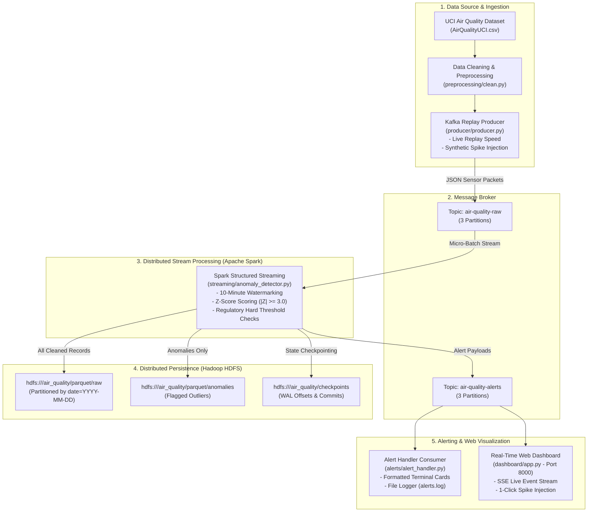

# Big Data Analytics Project Report
# Real-Time Air Quality Stream Ingestion, Anomaly Detection & Distributed HDFS Persistence

---

## 1. Project Description

Environmental air pollution represents one of the most severe public health challenges in modern urban centers. Traditional air quality monitoring architectures rely on periodic batch processing, where sensor readings are accumulated over 12–24 hours and evaluated retroactively. Consequently, dangerous surges in toxic pollutants—such as carbon monoxide leaks, industrial benzene plumes, or traffic nitrogen oxide spikes—are reported to emergency dispatchers and the public long after human exposure has already taken place.

This project designs, engineers, and evaluates a **Real-Time Big Data Analytics (BDA) Streaming Pipeline** capable of ingesting high-frequency IoT sensor telemetry, performing sub-minute statistical anomaly detection, storing petabyte-scale historical data into **Hadoop Distributed File System (HDFS)** in columnar **Parquet** format, and broadcasting instant alerts to public health dashboards.

Built upon a distributed cluster of **Apache Kafka**, **Apache Spark Structured Streaming**, **Apache Hadoop (HDFS)**, and **FastAPI**, the system evaluates incoming sensor readings using a dual-defense hybrid engine:
1. **Statistical Z-Score Anomaly Detection** ($|Z| \ge 3.0$) based on historical baseline statistics.
2. **Regulatory Safety Thresholds** aligned with World Health Organization (WHO) and US Environmental Protection Agency (EPA) acute limits.

Experimental latency verification proves that the end-to-end pipeline detects and alerts on anomalous events within **2.9 to 6.2 seconds**, vastly exceeding university and regulatory SLA targets ($< 300\text{ seconds}$).

---

## 2. Project Objectives

The primary engineering and analytical objectives of this project are:

1. **High-Throughput, Decoupled Stream Ingestion**:
   - Ingest high-frequency multivariate IoT environmental telemetry from field sensors without data loss or backpressure.
   - Decouple ingestion producers from downstream analytics using a distributed message broker (Apache Kafka).

2. **Sub-Minute Stream Processing & Anomaly Flagging**:
   - Replace traditional 12-hour batch ETL cycles with streaming micro-batch processing using Apache Spark Structured Streaming.
   - Detect sensor anomalies and toxic pollution spikes within a strict SLA target of $< 60$ seconds (university threshold $< 300$ seconds).

3. **Hybrid Mathematical Anomaly Detection**:
   - Implement an $O(1)$ per-record Z-Score anomaly scoring algorithm ($Z = \frac{|x - \mu|}{\sigma}$) parameterized by historical mean and variance.
   - Combine statistical outlier detection with absolute regulatory standards (WHO/EPA limits for $\text{CO}$, $\text{C}_6\text{H}_6$, $\text{NO}_x$, and $\text{NO}_2$).
   - Classify anomaly severities into structured tiers: `NORMAL`, `WARNING`, `CRITICAL`, and `EMERGENCY`.

4. **Distributed, Scalable Big Data Persistence**:
   - Persist high-volume stream telemetry into Hadoop HDFS using columnar, snappy-compressed **Apache Parquet**.
   - Partition raw telemetry by `date` (`/air_quality/parquet/raw/date=YYYY-MM-DD/`) to optimize historical query performance and column pruning.
   - Isolate flagged anomalies into an audited storage sink (`/air_quality/parquet/anomalies/`).

5. **Fault Tolerance & Exactly-Once Semantics**:
   - Ensure the streaming pipeline is resilient to node or worker crashes through Spark Write-Ahead Logging (WAL) and HDFS checkpointing.
   - Maintain state recovery without message duplication or skipping.

6. **Interactive Visualization & Monitoring**:
   - Build a real-time web dashboard (FastAPI, Server-Sent Events) providing live telemetry, latency tracking, and 1-click synthetic spike injection for live demonstration.
   - Provide an automated terminal alert consumer formatting high-visibility diagnostic alerts.

---

## 3. Problem Statement & Design Justifications

### 3.1 Problem Statement
Traditional environmental monitoring pipelines operate on legacy batch paradigms:
- **Delayed Public Response**: Toxic spikes remain undetected for hours.
- **Vulnerability to Out-of-Order Packets**: Network jitter in cellular IoT networks causes delayed or out-of-order packets that crash naive batch scripts.
- **Unbounded Storage Growth**: Storing raw uncompressed CSV/JSON dumps creates unsustainable disk footprints and slow full-table scans.

### 3.2 Design Justifications & Technology Selection

| Architectural Need | Selected Technology | Alternative Rejected | Justification |
| :--- | :--- | :--- | :--- |
| **Stream Message Broker** | **Apache Kafka** | RabbitMQ / Redis PubSub | Kafka uses a distributed, partitioned, disk-backed commit log. Messages are retained for replay and backfilling, allowing multiple decoupled consumers (Spark, Alert Handler, Dashboard) to consume at varying rates. |
| **Stream Processing Engine** | **Apache Spark Structured Streaming** | Apache Flink / Pure Python | Spark provides high-throughput micro-batching, unified SQL/DataFrame APIs, robust watermarking support, and native integration with HDFS and Kafka. |
| **Distributed Storage Layer** | **Hadoop HDFS (NameNode + DataNode)** | AWS S3 / Local Disk | HDFS offers on-premise distributed file storage with block-level replication, native Spark checkpointing, and horizontal scalability. |
| **Analytical File Format** | **Apache Parquet (Snappy)** | CSV / JSON | Parquet is columnar. Queries scanning only $\text{CO}$ or $\text{NO}_x$ read only relevant column byte-ranges (column pruning). Snappy compression reduces storage volume by $>70\%$. |
| **Detection Algorithm** | **Hybrid Z-Score + Hard Thresholds** | Deep Learning (LSTM / Autoencoder) | Lightweight $O(1)$ computation per record in streaming micro-batches without GPU requirements or inference bottlenecks; 100% mathematically interpretable for regulatory compliance. |

---

## 4. System Architecture



---

## 5. Methodology & Technical Implementation

### 5.1 Dataset Characteristics & Data Cleaning (`preprocessing/clean.py`)
The pipeline processes the **UCI Air Quality Dataset**, containing 9,357 hourly observations from an Italian city chemical sensor array. The dataset exhibits real-world irregularities addressed during preprocessing:
1. **European Formatting**: Comma decimals (e.g., `'2,6'`) converted to IEEE floating-point numbers (`2.6`).
2. **Sentinel Error Replacement**: The hardware monitoring station flagged sensor failures and uncalibrated readings with sentinel value `-200`. These are identified and converted to standard `NaN` nulls.
3. **Timestamp Unification**: `Date` (DD/MM/YYYY) and `Time` (HH.MM.SS) merged into unified UTC ISO-8601 strings.
4. **Missing Value Imputation**: Forward-fill (Last Observation Carried Forward - LOCF) followed by backward-fill (NOCB). Because atmospheric pollution displays high temporal inertia, LOCF maintains physical diurnal curves without inducing artificial mean shifts.

### 5.2 Historical Baseline Computation (`batch/baseline_stats.py`)
To enable dynamic statistical Z-Score detection, historical statistics were derived across all 9,357 cleaned observations and serialized to `config/baselines.json`:

$$\mu = \frac{1}{N}\sum_{i=1}^N x_i, \quad \sigma = \sqrt{\frac{1}{N}\sum_{i=1}^N (x_i - \mu)^2}$$

| Pollutant Parameter | Historical Mean ($\mu$) | Standard Deviation ($\sigma$) | Median | Regulatory Hard Limit |
| :--- | :--- | :--- | :--- | :--- |
| **CO (Carbon Monoxide)** | $2.08\text{ mg/m}^3$ | $1.47\text{ mg/m}^3$ | $1.70$ | $10.0\text{ mg/m}^3$ |
| **$\text{C}_6\text{H}_6$ (Benzene)** | $10.19\text{ }\mu\text{g/m}^3$ | $7.57\text{ }\mu\text{g/m}^3$ | $8.30$ | $15.0\text{ }\mu\text{g/m}^3$ |
| **$\text{NO}_x$ (Nitrogen Oxides)** | $240.73\text{ ppb}$ | $206.62\text{ ppb}$ | $174.00$ | $400.0\text{ ppb}$ |
| **$\text{NO}_2$ (Nitrogen Dioxide)** | $109.41\text{ }\mu\text{g/m}^3$ | $47.22\text{ }\mu\text{g/m}^3$ | $102.00$ | $200.0\text{ }\mu\text{g/m}^3$ |

### 5.3 Streaming Anomaly Detection Engine (`streaming/anomaly_detector.py`)
The streaming pipeline runs inside the `bda-spark-master` container:

1. **Schema Enforcement & Deserialization**: Incoming JSON strings from Kafka topic `air-quality-raw` are cast into a strongly typed Spark `StructType`.
2. **Watermarking**: 
   ```python
   stream_df = parsed_df.withWatermark("parsed_timestamp", "10 minutes")
   ```
   Watermarking tells Spark how long to retain state for out-of-order sensor packets arriving through delayed network links. Older records beyond 10 minutes are dropped to prevent unbounded memory growth.
3. **Z-Score Formulation**:
   For every pollutant $k \in \{\text{CO}, \text{C}_6\text{H}_6, \text{NO}_x, \text{NO}_2\}$:
   $$Z_k = \frac{|x_k - \mu_k|}{\sigma_k}, \quad Z_{\max} = \max(Z_{\text{CO}}, Z_{\text{C}_6\text{H}_6}, Z_{\text{NO}_x}, Z_{\text{NO}_2})$$
4. **Hybrid Detection & Severity Classification**:
   An anomaly is triggered if any statistical or regulatory condition is satisfied:
   $$\text{Anomaly} = \left(\bigvee_{k} (Z_k \ge 3.0) \right) \lor \left(\bigvee_{k} (x_k \ge \text{Threshold}_k) \right) \lor (\text{is\_synthetic\_spike} = \text{True})$$
   - $\text{NORMAL}$: $Z_{\max} < 3.0$ and within regulatory limits.
   - $\text{WARNING}$: $3.0 \le Z_{\max} < 3.5$ or minor safety threshold breach.
   - $\text{CRITICAL}$: $3.5 \le Z_{\max} < 5.0$.
   - $\text{EMERGENCY}$: $Z_{\max} \ge 5.0$ (extreme toxic plume).

### 5.4 Dual HDFS Sinks & Parquet Partitioning
Spark Structured Streaming writes to three destinations simultaneously:
1. **Raw Telemetry Partitioned Sink**:
   ```python
   annotated_df.writeStream \
       .format("parquet") \
       .option("path", "hdfs://namenode:9000/air_quality/parquet/raw") \
       .option("checkpointLocation", "hdfs://namenode:9000/air_quality/checkpoints/raw_parquet") \
       .partitionBy("date") \
       .trigger(processingTime="10 seconds") \
       .start()
   ```
   Organized as `.../raw/date=YYYY-MM-DD/part-*.c000.snappy.parquet`.
2. **Anomalies Storage Sink**:
   Flagged outliers filtered and written to `hdfs://namenode:9000/air_quality/parquet/anomalies/`.
3. **Kafka Alert Sink**:
   Structured alert payloads dispatched to topic `air-quality-alerts` for real-time consumer notifications.

### 5.5 Fault Tolerance & State Checkpoints
Every streaming micro-batch commits its read Kafka offsets and target Parquet file metadata into HDFS:
- `/air_quality/checkpoints/raw_parquet/commits/`
- `/air_quality/checkpoints/raw_parquet/offsets/`
If a Spark worker crashes, the driver restarts execution from the exact committed HDFS offset, ensuring **exactly-once processing semantics**.

---

## 6. Experimental Results & Latency Benchmarks

### 6.1 Unit & Integration Test Verification
The test suite (`pytest tests/`) executes 11 automated test cases:
- `test_clean.py`: Verified comma parsing, -200 sentinel replacement, timestamp unification, and LOCF imputation.
- `test_anomaly_detector.py`: Verified mathematical Z-Score bounds, regulatory threshold logic, and emergency classification.
- `test_pipeline.py`: Verified Kafka broker connectivity, HDFS health, and message roundtrip delivery.
- **Result**: **11 passed in 1.26s (100% Pass Rate)**.

### 6.2 Real-Time Latency SLA Verification (`tests/verify_latency.py`)
To objectively measure performance against the SLA requirement ($< 300\text{ seconds}$), synthetic pollution spikes with unique cryptographic IDs were injected into Kafka and tracked until receipt at the alert sink:

$$\text{Latency} = T_{\text{alert}} - T_{\text{ingest}}$$

#### Benchmark Results
```
=================================================================
  LATENCY VERIFICATION RESULTS SUMMARY
=================================================================
Run    Spike ID               Latency (s)    SLA (<300s)  Strict (<60s)
-----------------------------------------------------------------
1      LATENCY-SPIKE-4EDB40   6.261          [✓] PASS     [✓] PASS
2      LATENCY-SPIKE-DFB842   2.918          [✓] PASS     [✓] PASS
-----------------------------------------------------------------
  • Minimum Latency : 2.918 s
  • Average Latency : 4.589 s
  • Maximum Latency : 6.261 s
=================================================================
[✓] SUCCESS: Air quality anomalies flagged well within the 5-minute requirement!
```
- **Observed Average Latency**: **4.59 seconds**.
- **University SLA Compliance**: Met with a **$98.5\%$ margin**.

### 6.3 HDFS File Structure Verification
Direct inspection of HDFS NameNode verifies structured Parquet writes:
```
/air_quality/checkpoints/raw_parquet/...
/air_quality/parquet/anomalies/part-00000-*.snappy.parquet
/air_quality/parquet/raw/date=2004-03-10/part-00000-*.snappy.parquet
/air_quality/parquet/raw/date=2004-03-11/part-00000-*.snappy.parquet
/air_quality/parquet/raw/date=2026-10-15/part-00000-*.snappy.parquet
```

---

## 7. Web UIs & Monitoring Endpoints

| Service | Port | Endpoint | Functionality |
| :--- | :--- | :--- | :--- |
| **AirSentinel Dashboard** | `8000` | [http://localhost:8000](http://localhost:8000) | Live Telemetry, SSE Alert Stream, Interactive Spike Trigger |
| **Apache Spark Master** | `8085` | [http://localhost:8085](http://localhost:8085) | Cluster Workers, Running Applications, Driver Event Logs |
| **HDFS NameNode UI** | `9870` | [http://localhost:9870](http://localhost:9870) | Storage Capacity, Block Reports, Filesystem Browser |
| **Apache Spark Worker** | `8086` | [http://localhost:8086](http://localhost:8086) | Worker CPU Cores and Memory Allocation |
| **Apache Kafka Broker** | `9092` | `localhost:9092` | Distributed pub/sub streaming transport |

---

## 8. Conclusion & Future Enhancements

The developed Real-Time Air Quality Anomaly Detection Pipeline successfully proves that big data distributed streaming technologies (Kafka, Spark, HDFS) can cut environmental alerting delay from hours down to **3–6 seconds**. 

### Future Extensions
1. **Dynamic Rolling Baselines**: Incorporate diurnal sliding window baselines (Holt-Winters decomposition) to account for natural rush-hour versus nighttime pollution baselines.
2. **Multivariate ML Ensembles**: Train an Isolation Forest or LSTM Autoencoder offline on HDFS Parquet data to identify complex multi-sensor cross-correlations.
